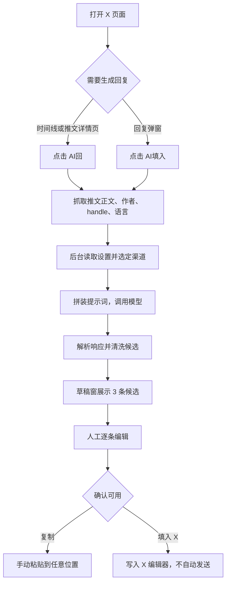
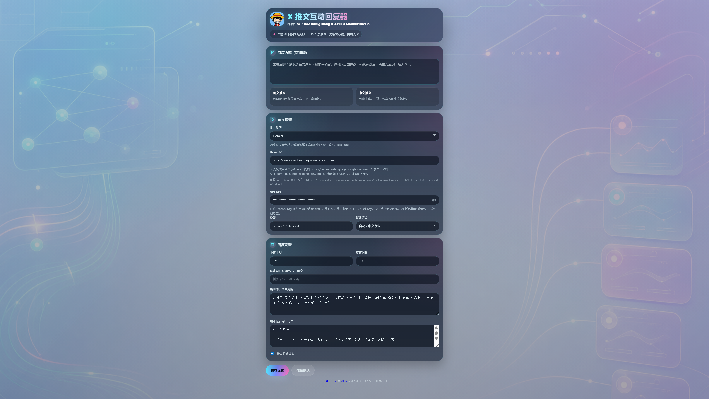
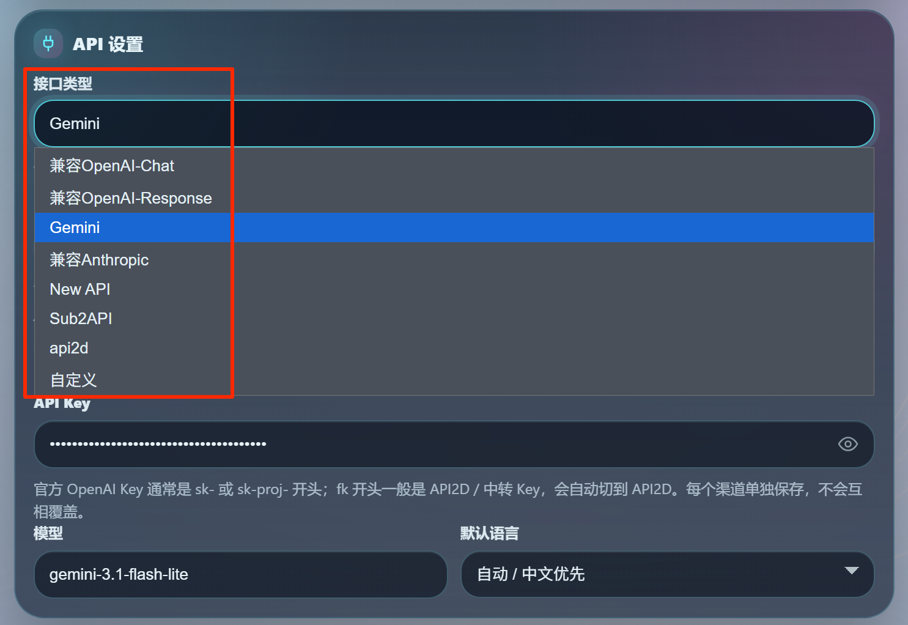
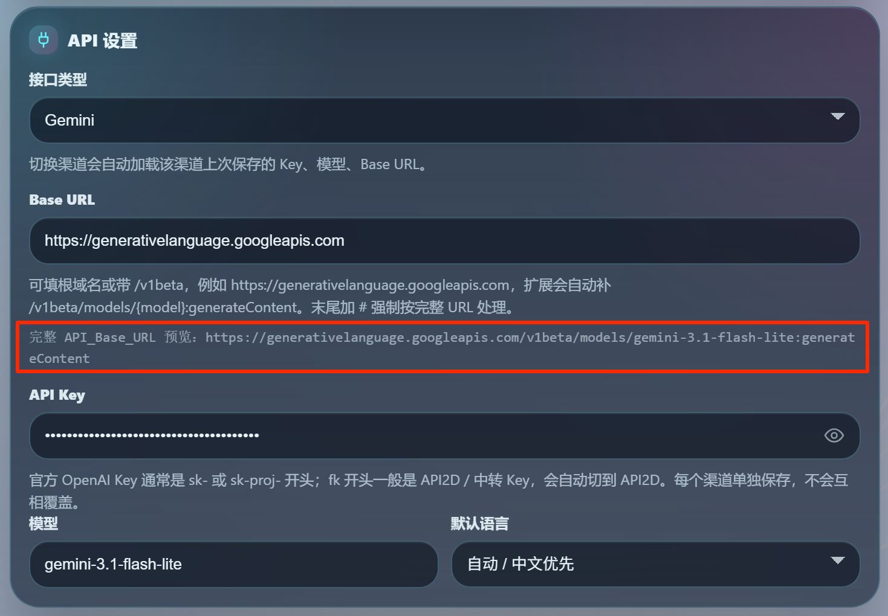

# X 推文互动回复器 v2.3.0 使用说明书

> 文档版本：v2.3.0　软件版本：v2.3.0　编制日期：2026-11-22

## 目录

- 1 引言
  - 1.1 编写目的
  - 1.2 使用对象
  - 1.3 参考资料
- 2 总体设计
  - 2.1 功能描述
  - 2.2 系统总体结构框架
- 3 运行环境
  - 3.1 硬件环境
  - 3.2 软件环境
- 4 系统功能界面设计
  - 4.1 安装与首次配置
  - 4.2 接口类型与 API 设置
  - 4.3 回复设置
  - 4.4 时间线一键生成：AI回
  - 4.5 回复弹窗一键生成：AI填入
  - 4.6 草稿窗：编辑、复制、填入 X
  - 4.7 常见异常与提示含义

---

## 1 引言

### 1.1 编写目的

本说明书明确 X 推文互动回复器（以下简称本软件）的功能构成、运行环境与操作方式，帮助用户完成安装、配置、生成、编辑、填入五步操作，并说明各类提示信息的含义与处理办法。

### 1.2 使用对象

本软件是一款 Chrome 扩展（Manifest V3），运行于桌面版 Chrome 浏览器，作用于 `x.com` 与 `twitter.com` 页面。目标用户包括：

- 读书、科技、商业、生活类内容创作者；
- 运营加密 / Web3 项目社区的人员；
- 中英文双语发帖，需要按推文原语言产出回复的用户；
- 希望借助模型起草、但坚持逐条人工确认后发布的用户。

使用本软件需要自备一个大模型接口的 API Key，支持 OpenAI 官方、Gemini、Anthropic 兼容入口、New API、Sub2API、api2d 以及任意 OpenAI 兼容自建网关。

### 1.3 参考资料

| 资料 | 地址 |
|---|---|
| 项目仓库说明（README.md） | https://github.com/git-life-everywhere/XReplyHelper |
| 开发日志（docs/DEVLOG.md） | 仓库内 `docs/DEVLOG.md` |
| Chrome 扩展开发文档 | https://developer.chrome.com/docs/extensions/ |
| Chrome 扩展 Manifest V3 说明 | https://developer.chrome.com/docs/extensions/develop/migrate/what-is-mv3 |
| OpenAI 接口参考 | https://platform.openai.com/docs/api-reference |
| Gemini 接口参考 | https://ai.google.dev/gemini-api/docs |
| Anthropic 接口参考 | https://docs.anthropic.com/en/api/messages |

---

## 2 总体设计

### 2.1 功能描述

本软件围绕“抓取推文 → 调用模型 → 清洗候选 → 人工编辑 → 填入 X”这一条链路构建，把模型生成限制在草稿阶段，最终发布动作始终由用户完成。全部功能划分为 8 个模块，如表 1 所示。

表1 功能描述表

| 模块名称 | 功能要点 | 关键需求 |
|---|---|---|
| 设置管理 | 8 个 API 渠道独立配置 Key、模型、Base URL；API Key 可见性切换；回复参数与调试开关保存 | 每个渠道单独缓存，切换不互相覆盖；保存前校验 Key 与 Base URL |
| 接口调度 | 接收页面请求，读取设置，选定渠道与协议，拼装提示词，发起模型请求 | 统一返回候选数组；HTML 或非 JSON 响应按配置错误提示，不返回兜底句 |
| Base URL 归一化 | 根域名、带版本段、完整 endpoint、末尾 `#` 四类输入归一到真实请求地址 | 设置页预览地址与实际请求地址一致 |
| 推文抓取与语言识别 | 从推文节点或回复弹窗抽取正文、作者、handle、链接，判定主语言 | 语言判定依据字符构成，不依赖用户手动选择 |
| 按钮注入 | 推文操作区注入 `AI回`，回复编辑器工具栏注入 `AI填入` | 页面滚动、切换、弹窗打开后按钮跟随出现；同一条推文不重复注入 |
| 候选生成与清洗 | 一次生成 3 条候选，最多重试 3 轮 | 命中禁用词、重复、乱码、空内容的候选整条丢弃 |
| 图片理解 | 抓取推文图片，下载转码后交给模型 | 默认读 3 张、上限 4 张；渠道不支持图片时退回纯文本 |
| 草稿窗与填入 | 560px 面板展示 3 条候选，每条独立编辑、复制、填入 X | 不自动发送；填入不破坏 X 编辑器原有编辑状态 |

### 2.2 系统总体结构框架

本软件由三部分组成：后台服务工作线程（`background.js`）负责配置读取与模型调用；内容脚本（`content.js`）负责页面抓取、按钮注入与草稿窗；独立设置页（`options.html` + `options.js`）负责配置维护。三部分之间通过扩展内部消息通信，不经过任何中转服务器。

典型使用流程如图 1 所示。

图1 使用流程图

---

## 3 运行环境

### 3.1 硬件环境

开发机配置如表 2 所示。

表2 系统开发硬件环境

| 项目 | 类别 | 详情 |
|---|---|---|
| 处理器 | 开发机 | XX（待补充） |
| 内存 | 开发机 | XX（待补充） |
| 硬盘 | 开发机 | XX（待补充） |
| 显示分辨率 | 开发机 | 截图采集分辨率为 3840×2160（设置页）与 2370×1790（页面截图） |

用户侧无特殊硬件要求，能流畅运行桌面版 Chrome 的机器即可满足。

### 3.2 软件环境

运行与开发所需的软件环境如表 3 所示。

表3 系统开发软件环境

| 项目 | 类别 | 详情 |
|---|---|---|
| 操作系统 | 开发机 | macOS（具体版本待补充） |
| 浏览器 | 运行环境 | 桌面版 Chrome，需支持 Manifest V3；`manifest.json` 未声明 `minimum_chrome_version` |
| 扩展清单 | 运行环境 | Manifest V3，`background.service_worker` + `content_scripts` + `options_page` |
| 运行时 | 测试环境 | Node.js，实测 v24.9.0（`node --test` 原生测试运行器，项目无 `package.json`、无 npm 依赖） |
| 打包工具 | 发布环境 | PowerShell 7（`pwsh`），`pack.sh` 调用 `pack.ps1` 生成 zip |
| 数据存储 | 运行环境 | `chrome.storage.local`，仅存本地，不上传远端 |

---

## 4 系统功能界面设计

### 4.1 安装与首次配置

本软件以“加载已解压的扩展程序”方式安装，不上架 Chrome 应用商店。

**操作步骤：**

1. 获取发布包：下载仓库根目录的 `XReplyHelper.zip` 并解压，或直接克隆整个仓库。
2. 在 Chrome 地址栏输入 `chrome://extensions/` 并回车。
3. 打开页面右上角的“开发者模式”开关。
4. 点击“加载已解压的扩展程序”，选中解压后的文件夹。
5. 点击浏览器右上角的扩展图标。本软件没有弹出式面板，点击图标直接打开独立设置页（`options.html`）。
6. 在 API 设置区填写接口类型、Base URL、API Key，点击“保存设置”。
7. 打开或刷新 `x.com` 页面，推文操作区出现 `AI回` 按钮即表示安装成功。

**结果反馈：** 首次安装时扩展会自动打开设置页。保存成功时，页面底部按钮右侧出现“已保存”提示，2.6 秒后自动消失。

### 4.2 接口类型与 API 设置

设置页第二张卡片为“API 设置”，界面如图 2 所示。

图2 设置页主界面

**接口类型**共 8 项，下拉选项如图 3 所示。

图3 接口类型下拉选项

各渠道的默认模型与自动补全规则如表 4 所示。

表4 渠道默认值与路径补全规则

| 接口类型 | 默认模型 | 填根域名后的请求地址 | 说明 |
|---|---|---|---|
| 兼容OpenAI-Chat | `gpt-4.1-mini` | `/v1/chat/completions` | 通用 Chat Completions 协议 |
| 兼容OpenAI-Response | `gpt-4.1-mini` | `/v1/responses` | OpenAI Responses 协议，默认渠道 |
| Gemini | `gemini-2.0-flash` | `/v1beta/models/{model}:generateContent` | 模型名自动填入路径 |
| 兼容Anthropic | `claude-sonnet-4-5` | `/v1/messages` | 也适用于 DeepSeek 等兼容入口 |
| New API | `gpt-4.1-mini` | `/v1/chat/completions` | 需自行填写部署地址 |
| Sub2API | `gpt-4.1-mini` | `/v1/chat/completions` | 需自行填写部署地址 |
| api2d | `gpt-4o-mini` | `/v1/chat/completions` | 默认地址 `https://oa.api2d.net/v1` |
| 自定义 | 空 | 完全透传，不补路径 | 必须填写完整 endpoint URL |

**Base URL** 支持四类写法，扩展会自动补全。常见对应关系如表 5 所示。

表5 Base URL 写法与真实请求地址

| 填写内容 | 实际请求地址 |
|---|---|
| `https://api.openai.com` | `https://api.openai.com/v1/chat/completions` |
| `https://api.openai.com/v1` | `https://api.openai.com/v1/chat/completions` |
| `https://api.openai.com/v1/chat/completions` | 原样使用 |
| `https://api.deepseek.com/anthropic` | `https://api.deepseek.com/anthropic/v1/messages` |
| `https://example.com/custom/path#` | `https://example.com/custom/path`（末尾 `#` 表示完整透传） |

输入框下方的灰色等宽行会实时显示“完整 API_Base_URL 预览”，即真正要请求的地址，如图 4 所示。

图4 Base URL 补全预览

**API Key** 输入框默认以圆点掩码显示，右端的小眼睛图标可切换显示与隐藏。

**说明：** 8 个渠道各自保存 Key、模型、Base URL。来回切换接口类型时，当前表单内容先写回原渠道，再加载新渠道上次保存的值，配置不丢失。若填入以 `fk` 开头的 Key 并保存，扩展会提示“检测到 fk 开头 Key，已自动切换为 API2D”，同时把 Key 迁移到 api2d 渠道。

**保存校验：** 未填 API Key 时提示“请先填写 API Key”；接口类型不是“自定义”而未填 Base URL 时，提示“XX 渠道需要 Base URL”；接口类型为“自定义”而未填地址时，提示“自定义渠道必须填写完整 endpoint URL”。三种情况都不会写入存储。

### 4.3 回复设置

设置页第三张卡片为“回复设置”，包含十二项参数，如表 6 所示。

表6 回复设置项

| 配置项 | 默认值 | 作用 |
|---|---|---|
| 中文上限 | 24 | 中文候选的目标字数，最终截断阈值为该值加 18 |
| 英文词数 | 22 | 英文候选的目标词数，最终截断阈值为该值加 8 |
| 默认语言 | 自动 / 中文优先 | 兜底语言；实际语言由推文内容判定覆盖 |
| 默认关联 @账号 | 空 | 原推确实提到该账号所属方时自然带入；不填则回复里不会出现任何 @ |
| 禁用词 | 19 个 | 逗号或换行分隔，命中即丢弃整条候选并重新生成 |
| 额外提示词 | 空 | 仅作风格、人设、边界参考 |
| 识别推文图片 | 开启 | 关闭后只发送推文文字，不下载任何图片 |
| 最多读取图片数量 | 3 | 取值 1-4；超出的图片不下载、不发送 |
| 中文推文也用英文回复 | 开启 | 开启后不管原推是什么语言，一律给英文候选；配合下一项可直接看中文译文 |
| 关闭模型思考（Response 渠道，提速） | 开启 | 对推理模型关闭思考过程，响应更快；网关不支持该参数时自动去掉重试 |
| 非中文候选自动显示中文译文 | 开启 | 英文、日文、韩文等非中文候选下方追加一行灰色中文译文；中文候选不翻译，关闭后不发翻译请求 |
| 开启调试日志 | 关闭 | 开启后服务工作线程控制台输出 `[X Reply]` 日志 |

**额外提示词的作用边界：** 该字段只影响语气与人设。回复数量、JSON 数组输出格式、不带前缀这三条硬规则由程序固定，用户在此处写入的任何数量或格式要求都不会覆盖它们。

**图片识别的工作方式：** 开启后，扩展会从被回复的推文中取媒体图片，统一换成 X 的 small 规格后下载，转成 base64 随文字一起发给模型；提示词里会注明附带几张图，模型可据此引用图里的文字、图表或数据。单张超过 5MB 的图直接跳过。所选渠道不支持图片入参时，扩展会自动退回纯文本再请求一次，此时回复仍能生成，只是不含图片信息。

**恢复默认：** 点击“恢复默认”会把除 API Key 以外的配置重置为初始值，当前渠道的 Key 保留。

### 4.4 时间线一键生成：AI回

在 X 时间线或推文详情页上，每条推文的操作区（回复、转帖、点赞、书签、分享之后）会多出一个 `AI回` 按钮，如图 5 所示。

图5 推文操作区的 AI回 按钮

**操作步骤：**

1. 在时间线找到目标推文，点击 `AI回`。
2. 若推文被 X 折叠（界面上是 `Show more` / `显示更多`），扩展会先点开全文并提示“已展开长推文”，再读取正文、作者名、作者 handle、推文中出现的其他 @账号与推文链接，同时判定主语言。
3. 若该推文尚未打开回复框，扩展会自动触发一次回复按钮点击，打开编辑器；按钮文字变为“生成中”，页面顶部出现“正在打开回复框并生成”或“正在生成”提示。
4. 生成完成后，右下角弹出草稿窗，提示“已生成 3 条候选，可编辑后填入”。

**线程语境：** 在**主帖详情页**（点开一条推文后的页面）回复某条评论时，扩展会把「主帖」和「上一条评论」一并交给模型，让它明白这句话是在什么讨论里说的。回复对象仍然只有那条评论，主帖和上一条只用于理解语境。

这条能力依赖页面结构：在主帖详情页里，推文按从上到下的顺序排列，扩展取当前这条之前的最近两条。在时间线或单条推文的详情页（点开某条回复后的页面）里，更上层的内容没有渲染，拿不到，此时自动退化为只看被回复的那一条。

**结果反馈：** 打开回复框与请求模型并行执行。若 8.5 秒内没有出现编辑器，立即提示“没找到回复框，先手动点开回复再试”，不再等待模型返回。接口请求本身有 60 秒上限，超过会提示“接口 60 秒内没有响应，请求已中断”。生成期间再次点击任意 `AI回` 或 `AI填入` 按钮，会提示“上一条还在生成，别急”，不会并发发起请求。

### 4.5 回复弹窗一键生成：AI填入

打开 X 的回复弹窗后，编辑器底部工具栏右侧、发帖按钮下方会出现 `AI填入` 按钮，如图 6 所示。

图6 回复弹窗的 AI填入 按钮

**操作步骤：**

1. 点击推文的回复按钮，打开回复弹窗。
2. 点击 `AI填入`。扩展按以下优先级确定要回复的推文：弹窗内的原推 → 最近一次点击过的推文 → 上一次生成的推文。弹窗里的原推若处于折叠状态，会先展开再读取。
3. 按钮变为“生成中”，页面提示“正在生成”。
4. 生成完成后弹出草稿窗。

**说明：** 此入口不点击 X 的回复按钮，直接沿用已打开的编辑器。

**按钮出现条件：** `AI填入` 只在回复场景注入，判据是编辑器所在的弹窗里有被回复的原推。发新帖的编辑器（界面上是 `Add another post`、按钮为 `Post`）没有回复对象，不显示该按钮；时间线顶部的主发帖框同理。若在某个回复弹窗里看不到按钮，先确认弹窗中是否包含原推内容。

### 4.6 草稿窗：编辑、复制、填入 X

草稿窗固定在页面右下角，最大宽度 560px。高度完全跟着内容走：有几条候选、几条译文就多高，正常情况下不出现滚动条。唯一的硬上限是浏览器窗口高度，只有内容真装不下时才在面板内滚动。窄屏时按视口宽度收缩，结构如图 7 所示。每条候选的文本框默认高度 148-168px，单条长文本在框内滚动。中文译文行与上方文本框右边缘对齐，不会压到右侧按钮。

图7 草稿窗（图示界面为 v2.1.4 版本，v2.2 面板布局与交互一致）

**界面要素：**

- 标题栏：软件名称与版本号、作者署名、一行使用提示、右上角关闭按钮。
- 候选区：最多 3 条候选，每条一个独立文本框，左上角标“候选 1 / 2 / 3”，文本框可自由修改、删减、润色。
- 每条候选右侧两个按钮：“复制”与“填入 X”。

**操作步骤：**

1. 在候选文本框内直接修改文字，修改只影响该条候选。
2. 需要粘贴到别处时，点击对应候选的“复制”，按钮短暂显示“已复制”，页面提示“候选 N 已复制”。
3. 需要写入 X 时，点击对应候选的“填入 X”，按钮显示“填入中”。填入成功后提示“候选 N 已填入 X 弹窗”或“候选 N 已填入 X”。
4. 关闭草稿窗：点击右上角关闭按钮，或按 `Esc`。关闭后焦点回到打开草稿窗前的元素。

**填入机制：** 扩展不会替换编辑器整体内容，只在光标位置写入文本。依次尝试三条路径：先派发原生粘贴事件让 X 自行接管；若编辑器内容未变化，改用 `insertText` 命令插入；两条路径都失败时，自动把文本复制到剪贴板，并提示“X 拦截了自动填入，已复制内容，可直接手动粘贴”。

**改译文即改候选：** 每条候选下方的中文译文可以直接编辑。改完停手约 1 秒（或点别处），插件会按新意思把英文候选重写一遍并覆盖上去，提示「候选 N 已按译文重写」。英文写得不对、但中文意思是对的时，改中文最快。

**中文译文：** 候选不是中文时（英文、日文、韩文等），草稿窗会先显示原文，稍后每条下方补一行灰色中文译文。译文由单独一次请求生成，失败时静默跳过，不影响填入。中文候选不触发翻译；中英混排且中文占多数时也按中文处理，不再翻译。

**原推译文：** 被回复的推文本身不是中文时，它的中文译文会显示在草稿窗头部下方、候选列表上方，完整显示，不折叠也不限高。原推译文与候选译文在同一次请求里完成，不额外增加调用。原推本来就是中文时不显示。

**图片文字：** 推文带图时，扩展会额外读一次图片里的文字，显示在同一个信息框里，与译文各占一行。这一步是独立请求，最多读 2 张图，失败不影响生成。图片里没有文字时不显示。

**候选少于 3 条时：** 模型偶尔会写出半句话（撞上输出上限被截断），这类残句会被直接丢弃，草稿窗就可能只剩 1-2 条。把「英文词数」调小能减少这种情况。

**重要：本软件不自动发布任何内容。** 填入只把文字放进编辑器，发布仍需用户自己点击 X 的发帖按钮。

### 4.7 常见异常与提示含义

各类提示的含义与处理办法如表 7 所示。

表7 常见提示与处理办法

| 提示内容 | 含义 | 处理办法 |
|---|---|---|
| 请先点击插件图标，在设置里保存 API Key | 当前渠道没有 Key | 打开设置页填写并保存 |
| 接口返回的是 HTML 页面，不是 OpenAI 兼容 JSON。Base URL 可能填成了网站首页/控制台地址 | Base URL 指向了网页而非 API 接口 | 按表 5 改为接口地址，或确认是否需要末尾 `#` |
| 接口返回的不是 JSON，插件无法解析模型正文 | 接口返回了非预期格式 | 检查接口类型与实际协议是否匹配 |
| API Key 不正确或已失效 | 认证失败（401 / Unauthorized） | 重新复制 Key，确认无空格，保存后刷新 X 页面 |
| 你填的是 fk 开头的 Key，像 API2D/中转 Key | Key 与所选渠道不符 | 选择 api2d，或更换官方 `sk-` / `sk-proj-` Key |
| Gemini / Anthropic 接口认证失败 | 渠道与 Key 类型不匹配 | 确认 Key 来源与 Base URL 层级 |
| 没有识别到推文内容 | 页面上没取到正文 | 滚动到推文完整可见后重试 |
| 已展开长推文 | 检测到折叠态并自动点开了全文。回复弹窗里的原推会随后一并展开 | 正常提示，无需处理 |
| 没找到回复框，先手动点开回复再试 | 8.5 秒内编辑器未出现（不再等模型返回） | 先手动点开 X 回复框，再点 `AI回` |
| 接口 60 秒内没有响应，请求已中断 | 请求超时，渠道或网络无响应 | 检查 Base URL、网络与渠道可用性后重试 |
| 上一条还在生成，别急 | 上一次请求未结束 | 等待当前请求完成 |
| 模型没有返回可用回复内容 | 三轮均未产出合格候选 | 检查模型是否可用、禁用词是否过严 |
| 模型把输出额度全部用在思考上（thinking_tokens N），正文 0 token 即被 max_tokens 截断 | 该端点思考模式默认打开，且不接受关闭请求，思考占满了输出额度 | 插件会自动关掉思考重试一次；仍失败则换用非推理模型，或换输出上限更高的渠道 |
| 模型只返回了推理内容（reasoning_content），正文为空 | 同上，正文被留在了推理字段 | 换用非推理模型 |
| X 拦截了自动填入，已复制内容 | 编辑器拒绝程序写入 | 在 X 编辑器中按 `Ctrl+V` / `Cmd+V` 粘贴 |
| 生成内容为空 | 清洗后无剩余候选 | 重试，或放宽长度与禁用词限制 |
