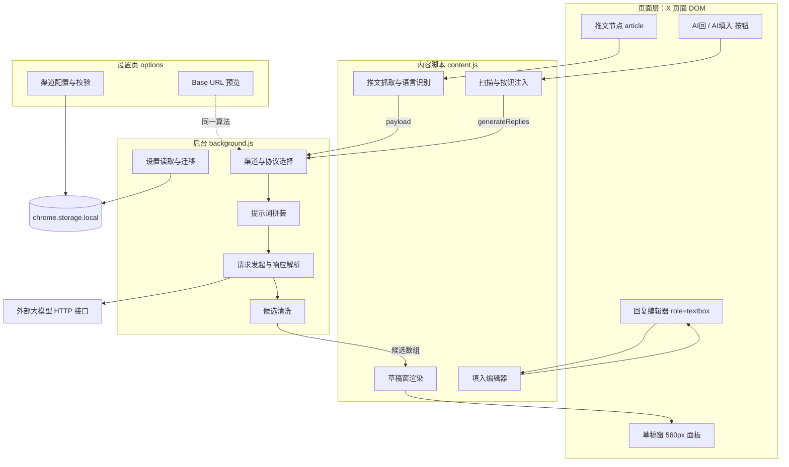

# X 推文互动回复器 v2.3.0 开发概要说明书

> 文档版本：v2.3.0　软件版本：v2.3.0　编制日期：2026-11-22

## 目录

- 1 引言
  - 1.1 项目背景
  - 1.2 编写目的
  - 1.3 参考资料
- 2 总体设计
  - 2.1 概述
  - 2.2 运行环境
  - 2.3 数据设计
- 3 系统架构
  - 3.1 整体架构
  - 3.2 功能模块
- 4 核心功能实现
  - 4.1 Base URL 归一化
  - 4.2 候选解析与清洗管线
  - 4.3 填入 X 的三重降级策略
  - 4.4 中英文自动识别
  - 4.5 推文图片理解
- 5 系统出错处理
  - 5.1 出错信息
  - 5.2 补救措施
  - 5.3 软件的维护

---

## 1 引言

### 1.1 项目背景

X（原 Twitter）的评论区互动是加密与 Web3 领域运营工作的日常动作，单条优质回复带来的曝光常高于原帖本身的二次分发。人工撰写回复受限于时间，而直接把模型输出贴进评论区，会暴露明显的模板腔：句式完整、面面俱到、堆叠“值得关注”“未来可期”“赋能生态”一类套话。这类内容在社区里辨识度极高，读者一眼能认出，消耗的是账号信誉。

本软件针对这一矛盾做了取舍：把模型能力限制在“起稿”环节，把“发布”环节完全留给人工。生成结果先进入可编辑草稿窗，用户逐条修改、删减后手动填入 X 编辑器，程序不持有任何自动提交能力。提示词层面则反向约束模型，要求短句、有判断、允许不确定与反问，主动规避营销腔。

软件基于上游项目 Akiii-v-1.9 演进，在其单条回复的基础上扩展出多渠道接口、3 条候选草稿窗、Base URL 智能补全、API Key 可见性切换等能力，形成 v2.x 系列。

按软件著作权申报要素归纳如下：

| 要素 | 内容 |
|---|---|
| 软件系统名称 | X 推文互动回复器（XReplyHelper） |
| 提出者 | 强子手记 @iBigQiang |
| 任务开发者 | 强子手记 @iBigQiang；上游作者 Akiii @Guomin184935 |
| 用户 | X / Twitter 内容创作者、项目社区运营人员、加密领域从业者 |
| 架构 | CS 混合结构：浏览器扩展客户端 + 用户自备的大模型 HTTP 接口，无自有服务端 |

上表署名依据仓库可见署名（`options.html`、草稿窗、README）整理，软著申报时请按实际约定核对提出者与开发者。

### 1.2 编写目的

（1）说明系统各功能模块的实现方式与职责边界；
（2）说明配置数据的字段构成、存储位置与迁移规则；
（3）确定模块划分、模块间消息协议与调用链路；
（4）说明请求构造、响应解析、候选清洗的关键规则；
（5）说明出错信息的分类与分层补救策略，供后续维护与二次开发者阅读。

### 1.3 参考资料

| 资料 | 地址 |
|---|---|
| 项目仓库 | https://github.com/git-life-everywhere/XReplyHelper |
| 上游项目 Akiii-v-1.9 | https://github.com/futakocui008/Akiii-v-1.9 |
| 开发日志（docs/DEVLOG.md） | 仓库内 `docs/DEVLOG.md` |
| 使用说明书（docs/使用说明书.md） | 仓库内 `docs/使用说明书.md` |
| Chrome 扩展 Manifest V3 | https://developer.chrome.com/docs/extensions/develop/migrate/what-is-mv3 |
| Chrome 扩展消息通信 | https://developer.chrome.com/docs/extensions/develop/concepts/messaging |
| Chrome 扩展存储 API | https://developer.chrome.com/docs/extensions/reference/api/storage |
| OpenAI 接口参考 | https://platform.openai.com/docs/api-reference |
| Gemini 接口参考 | https://ai.google.dev/gemini-api/docs |
| Anthropic Messages 接口 | https://docs.anthropic.com/en/api/messages |

---

## 2 总体设计

### 2.1 概述

软件为 Chrome Manifest V3 扩展，不依赖任何第三方运行时库，不使用打包器，源码即产物。全部能力划分为 8 个模块，如表 1 所示。该表与使用说明书共用同一套划分与术语。

表1 功能描述表

| 模块名称 | 功能要点 | 关键需求 |
|---|---|---|
| 设置管理 | 8 个 API 渠道独立配置 Key、模型、Base URL；API Key 可见性切换；回复参数与调试开关保存 | 每个渠道单独缓存，切换不互相覆盖；保存前校验 Key 与 Base URL |
| 接口调度 | 接收页面请求，读取设置，选定渠道与协议，拼装提示词，发起模型请求 | 统一返回候选数组；HTML 或非 JSON 响应按配置错误提示，不返回兜底句 |
| Base URL 归一化 | 根域名、带版本段、完整 endpoint、末尾 `#` 四类输入归一到真实请求地址 | 设置页预览地址与实际请求地址一致 |
| 推文抓取与语言识别 | 从推文节点或回复弹窗抽取正文、作者、handle、链接，判定主语言 | 语言判定依据字符构成，不依赖用户手动选择 |
| 按钮注入 | 推文操作区注入 `AI回`，回复编辑器工具栏注入 `AI填入` | 页面滚动、切换、弹窗打开后按钮跟随出现；同一条推文不重复注入 |
| 候选生成与清洗 | 一次生成 3 条候选，最多重试 3 轮 | 命中禁用词、重复、乱码、空内容的候选整条丢弃 |
| 图片理解 | 抓取推文图片，下载转 base64，按渠道拼多模态入参 | 默认读 3 张、上限 4 张；单张超 5MB 跳过；渠道拒绝图片时退回纯文本 |
| 草稿窗与填入 | 560px 面板展示 3 条候选，每条独立编辑、复制、填入 X | 不自动发送；填入不破坏 X 编辑器原有编辑状态 |

### 2.2 运行环境

#### 2.2.1 硬件环境

开发机配置如表 2 所示。

表2 系统开发硬件环境

| 项目 | 类别 | 详情 |
|---|---|---|
| 处理器 | 开发机 | XX（待补充） |
| 内存 | 开发机 | XX（待补充） |
| 硬盘 | 开发机 | XX（待补充） |
| 显示分辨率 | 开发机 | 设置页截图采集于 3840×2160，页面截图采集于 2370×1790 |

#### 2.2.2 软件环境

运行与开发所需的软件环境如表 3 所示。

表3 系统开发软件环境

| 项目 | 类别 | 详情 |
|---|---|---|
| 操作系统 | 开发机 | macOS（具体版本待补充） |
| 浏览器 | 运行环境 | 桌面版 Chrome，需支持 Manifest V3；未声明 `minimum_chrome_version` |
| 扩展清单 | 运行环境 | `manifest_version: 3`，`background.service_worker`、`content_scripts`、`options_page` |
| 运行时 | 测试环境 | Node.js，实测 v24.9.0；项目无 `package.json`，测试直接用 `node --test` |
| 打包工具 | 发布环境 | PowerShell 7（`pwsh`），由 `pack.sh` 调用 `pack.ps1` |
| 数据存储 | 运行环境 | `chrome.storage.local` |
| 第三方依赖 | 运行环境 | 无。原生 JavaScript，无 npm 依赖，无打包产物 |

### 2.3 数据设计

软件不使用数据库与远端存储，也不保存用户推文内容。唯一持久化数据是配置项，存放于 `chrome.storage.local`，键值如表 4 所示。

表4 配置存储字段

| 字段 | 类型 | 默认值 | 说明 |
|---|---|---|---|
| `provider` | string | `openai_responses` | 当前激活渠道，取值见 3.2.1 |
| `apiKey` | string | 空 | 当前渠道 Key 的顶层镜像 |
| `model` | string | `gpt-4.1-mini` | 当前渠道模型的顶层镜像 |
| `apiBase` | string | `https://api.openai.com/v1` | 当前渠道 Base URL 的顶层镜像 |
| `api2dBase` | string | `https://oa.api2d.net/v1` | 旧版字段，仅用于迁移回填 |
| `providerProfiles` | object | 8 个渠道对象 | 每渠道独立保存 `apiKey` / `model` / `apiBase` / `customProtocol` |
| `defaultLanguage` | string | `zh` | `zh` 或 `en`，作为语言兜底值 |
| `defaultStyle` | string | `sharp` | 风格标识，当前仅一个取值 |
| `maxChineseChars` | number | 24 | 中文长度软上限 |
| `maxEnglishWords` | number | 22 | 英文词数软上限 |
| `visionEnabled` | boolean | `true` | 是否读取推文图片 |
| `maxPhotos` | number | 3 | 每次最多读取的图片数量，取值 1-4 |
| `forceEnglishReplies` | boolean | `true` | 中文推文是否也用英文回复 |
| `disableReasoning` | boolean | `true` | Response 渠道是否关闭模型思考 |
| `autoTranslate` | boolean | `true` | 非中文候选是否自动生成中文译文 |
| `bannedWords` | string | 19 个词 | 逗号或换行分隔 |
| `projectHandle` | string | 空 | 默认关联 @账号 |
| `customPrompt` | string | 空 | 额外风格提示词 |
| `debugMode` | boolean | `false` | 控制 `log()` 是否输出 |

顶层四个字段（`apiKey` / `model` / `apiBase` / `api2dBase`）为兼容 v2.0 遗留，读取时若对应渠道的 profile 为空则回填；写入时以 `providerProfiles` 为准。老版本 `provider` 取值 `chat` 在读取时映射为 `openai_chat`，无法识别的取值回落为 `openai_responses`。该迁移逻辑在 `background.js` 的 `migrateSettings()` 与 `options.js` 的 `load()` 中各自实现一份，两边需同步修改。

---

## 3 系统架构

### 3.1 整体架构

软件为三层结构：页面层（X 页面 DOM）、扩展内容脚本层、扩展后台层，另加一个独立设置页。后台不持有 DOM，内容脚本不发网络请求，两者职责不重叠。整体架构如图 1 所示。



图1 整体架构图

架构选择的考虑：内容脚本运行在页面上下文，能直接读写 X 的 DOM，但受同源策略约束，跨域请求放在后台 Service Worker 中发起；Service Worker 无 DOM 且会被浏览器挂起，因此不承载任何状态，每次请求都从存储重新读取配置，保证挂起唤醒后行为一致。

### 3.2 功能模块

#### 3.2.1 后台调度模块（background.js）

该模块承担配置读取、渠道选择、请求构造、响应解析与候选清洗五项职责，是唯一的网络出口。

渠道共 8 个：`openai_chat`、`openai_responses`、`gemini`、`anthropic`、`newapi`、`sub2api`、`api2d`、`custom`。渠道到实际请求协议的映射如表 5 所示。

表5 渠道与协议映射

| 渠道 ID | 请求协议 | 鉴权方式 | 端点 |
|---|---|---|---|
| `openai_chat` | Chat Completions | `Authorization: Bearer` | `/v1/chat/completions` |
| `openai_responses` | Responses | `Authorization: Bearer` | `/v1/responses` |
| `gemini` | generateContent | `x-goog-api-key` 头 | `/v1beta/models/{model}:generateContent` |
| `anthropic` | Messages | `x-api-key` + `anthropic-version` | `/v1/messages` |
| `newapi` | Chat Completions | `Authorization: Bearer` | `/v1/chat/completions` |
| `sub2api` | Chat Completions | `Authorization: Bearer` | `/v1/chat/completions` |
| `api2d` | Chat Completions | `Authorization: Bearer` | `/v1/chat/completions` |
| `custom` | 由 `customProtocol` 决定 | 随协议 | 用户填写的完整 URL |

渠道选择存在一条覆盖规则：若 Key 以 `fk` 开头，无论用户选了哪个渠道，实际生效渠道强制为 `api2d`。该规则在后台与设置页各实现一次，用于降低把 API2D Key 配在 OpenAI 官方接口上的报错率。`newapi` 与 `sub2api` 的 Key 同为 `sk-` 开头，不受该规则影响。

消息协议共三个动作，如表 6 所示。

表6 模块间消息协议

| action | 请求字段 | 响应字段 | 用途 |
|---|---|---|---|
| `generateReplies` | `payload`、`count` | `ok`、`replies[]`、`error` | 批量生成候选，页面固定传 `count: 3` |
| `generateReply` | `payload` | `ok`、`reply`、`error` | 单条生成，当前页面未使用，保留兼容 |
| `translateReplies` | `texts[]` | `ok`、`translations[]`、`error` | 把非中文文本批量翻成中文；候选与原推原文合并成一次请求，最多 6 条 |
| `describePhotos` | `photos[]` | `ok`、`text`、`error` | 读出图片里的文字，供草稿窗顶部展示；独立视觉请求，最多 2 张 |
| `rewriteReply` | `text` | `ok`、`text`、`error` | 把用户改过的中文译文改写成英文候选，覆盖草稿窗里那一条 |
| `getSettings` | 无 | `ok`、`settings` | 读取设置，返回时 `apiKey` 以 `***` 脱敏 |

`payload` 字段包括：`tweetText`、`author`、`authorHandle`、`mentionedHandles`、`url`、`language`、`style`、`extraBannedWords`、`projectHandle`、`photos`、`threadRoot`、`threadPrev`。`threadRoot` 与 `threadPrev` 是线程语境：主帖与当前条之前的那条推文，各截断 600 字符，只在 `buildInput()` 里拼进「线程语境」段，不改变回复对象。注入提示词时只用 `projectHandle`——`mentionedHandles` 仅作采集记录，不参与「可带 @」的判断，避免作者本人的 handle 被当成项目方账号写进回复。`photos` 为图片数组，每项含 `url` 与 `alt`，由内容脚本采集，下载与编码在后台完成。

提示词由 `buildInstructions()` 拼装。v2.5.0 起只保留硬约束，篇幅约 300 字符：

```
你在帮用户回复一条 X 推文，写出能直接发进评论区的回复。

- 原推英文就回英文，中文就回中文
- 每条 N 词/字左右，口语，短句，像真人随手打的
- 不要写成小作文，不要分析、总结、讲道理

只用原推文字和图片里的内容，不要编造原文没有的东西。
图片用来看懂语境，不要描述画面里的人物长相、表情。

本次风格：…　禁用词：…
输出 JSON 数组，3 条。
```

这是一个反直觉的结论：**规则越多，输出越差**。

v2.4.0 曾把提示词整理成「任务-分工-写法-边界」四段、22 条规则，功能上覆盖所有已知问题，但实际输出始终是论述体。对照实验说明了原因——同一个模型，用一句自然语言请求（「我要回复这条推文，你看怎么回合适」）就写出了短、直接、像人话的回复；而 22 条规则下，模型把注意力全花在检查约束上，产出的是合规产物。

v2.5.0 的取舍：只保留模型自己判断不了的东西（语言、长度、输出格式、不编造、不描述图片），其余交给模型。原先针对具体偏差写的规则（不改褒贬、提问先答、不换例子等）全部撤掉，对应问题如果复发，再针对性补一条，而不是重新堆回去。

信息边界是 v2.3.1 起逐步积累、v2.4.0 合并定稿的一组规则，管住下面八种偏差：

| 偏差 | 实例 | 规则 |
|---|---|---|
| 编造原文没有的具体事物 | 原推只说「一杯水」，回复里出现「文档」「会议」 | 信息只能来自原推文字和图片；信息太少就只说那句话本身 |
| 一条候选里塞两个相反立场 | 前半句否定原推，后半句又说「也行」 | 给判断，不写论述；观点说完就停 |
| 对纯感受型推文挑刺、篡改评价倾向 | 原推说新书味 good、旧书味更好，回复把新书说成 smell like a factory | 原文在分享感受时顺着共鸣，不挑刺；不改原文的褒贬 |
| 描述配图里的人物 | 原推只有一张人物照片，回复写「看他脸上的表情，平静、耐心、几乎觉得好笑」 | 图片只用来看懂语境，不描述画面里的人物长相、表情、神态、衣着 |
| 靠换话题制造角度差异 | 原推讲书的气味，一条候选扯到「所以不买电子书」 | 差异来自同一件事的不同侧面，不引入原文没有的新概念 |
| 编造具体数字、年份、地点 | 原推没有年份，候选写「a cracked spine from 1974」 | 不编造原作没有的具体数字、年份、地点 |
| 把原文举的例子换掉或重新归类 | 原推举例「高薪耗命的工作」「易坏的便宜货」，候选换成「订阅、习惯、义务」来讨论 | 原文举了哪个例子就沿着说，不改换成别的类别，不给原文没提的东西新建分类 |
| 回避原推的提问，只接情绪 | 原推问「What are you reading?」，三条里两条只谈感受、没说自己读什么 | 提问先直接回答，再补充；不确定的具体信息用类型或模糊说法 |
| 为凑答案硬编具体信息 | 模型不知道用户真在读什么，写死「a slow mystery」 | 书名、作者、数字不确定时不硬编 |

请求参数固定为温度 0.85；输出上限按候选数计算：单条 800，多条取 `max(1600, 候选数 × 500)`。推理模型的思考过程与正文共用这一额度，额度不足时会出现思考占满、正文为 0 token 的情况，因此该值按留足思考预算设定。

Anthropic 兼容渠道另有一条降级规则：请求照常发出，若响应里只有 `thinking` 块、没有 `text` 块，说明该端点的思考模式默认打开且已占满额度（DeepSeek 系列即如此），程序把 `thinking` 设为 `disabled` 后重试一次。插件只生成几十个词的短评论，思考过程没有收益，因此不需要人工干预；端点若不接受该字段，重试失败后按 5.1 的模型输出类提示报错。

#### 3.2.2 内容脚本模块（content.js）

该模块负责一切 DOM 操作，包括扫描注入、内容抓取、语言判定、草稿窗渲染与文本填入。

按钮注入采用三路触发：`MutationObserver` 监听 `childList`、`subtree` 与指定属性变化（`class`、`style`、`hidden`、`aria-hidden`、`disabled`、`aria-disabled`、`data-testid`、`role`）；窗口滚动与获得焦点各触发一次；页面加载后按 450、1000、1800、3200、5200 毫秒五个时间点补扫。所有触发均经 260 毫秒防抖后合并执行一次扫描。URL 变化时清空缓存的推文上下文并重新排布补扫。

`AI回` 按钮挂在推文操作区。详情页的主推文结构不同，注入点改为主推文信息区，通过类名 `akiii-detail-meta` 区分两套样式。按钮携带 `data-akiii-status-id`，取值来自推文链接中的状态号；扫描时先收集同一推文下的既有按钮，多出的删除、保留首个并移动到当前宿主节点，避免重复注入与错位。

`AI回` 按钮的点击上下文按**按钮当前所在的 article** 取，而不是创建时闭包捕获的那个：X 是虚拟列表，按钮会被复用到别的推文下方，闭包里的 article 会过期，导致用 A 推文的内容给 B 推文生成。`AI填入` 同理，点击时先确认按钮仍在文档中，锚点失效则退回创建时的值。

`AI填入` 按钮挂在回复编辑器所在的编辑器容器上，插入位置优先取发帖按钮的父节点的发帖按钮之前，其次取工具栏末尾。注入前先经 `isReplyComposer()` 判定场景：编辑器的 `aria-label` 含 `reply` 或“回复”直接放行，否则要求所在弹窗内存在原推节点。发帖框（`Add another post`、`Post`）没有回复对象，不注入——该场景取不到上下文，注入后点击只能报错，且插入点按回复弹窗的布局计算，落到发帖框里会浮在发帖按钮上方。

读取正文前先展开折叠：X 对长推只渲染折叠版，DOM 里没有全文，直接读会让模型基于残句生成。`expandLongTweet()` 先按 `data-testid` 找展开控件，找不到再按 `Show more` / `显示更多` 文案兜底，且排除正文内同名文字；点击后等待 360 毫秒再读取。`AI回` 展开时间线的推文，`AI填入` 展开回复弹窗内的原推。`AI回` 打开回复弹窗后，还会用 `waitForDialog()` 拿一次弹窗并异步展开其中原推——正文此时已读到，这次展开只为视觉一致，因此不 `await`，不拖慢生成。

推文抓取优先读取 `div[data-testid=tweetText]` 节点的可见文本；取不到时克隆节点、移除按钮与图标等干扰元素后按行取前 24 行。同一节点内还会收集媒体图片（见 4.5），随 `payload.photos` 一并交给后台。同时抽取作者名、作者 handle、正文中出现的其他 handle（最多 8 个，排除作者本人）与推文链接。

#### 3.2.3 设置页模块（options.html / options.js）

该模块为独立页面，通过 `options_page` 注册，扩展图标点击事件由 `chrome.action.onClicked` 直接打开本页。不使用 `default_popup`，目的是避免弹出式面板在切换标签页或失去焦点时自动关闭，导致填写中的配置丢失。

页面分四张卡片：头部信息区、回复内容说明、API 设置、回复设置。API 设置卡片内切换渠道时，先把当前表单内容写回原渠道的 profile，再加载新渠道的值，实现 8 套配置互不覆盖。

校验在写存储之前执行，三类失败均以状态行红字呈现，不写入存储。

#### 3.2.4 打包与测试模块

测试使用 Node 原生 test runner，不引入测试框架。用例分布在 `tests/` 下 6 个文件，覆盖后台生成路径（在 `vm` 沙箱中加载 `background.js`）、内容脚本结构断言、CSS 约束、清单行为与 Base URL 预览算法。当前用例总数为 118 条，全部通过。

打包由 `pack.sh` 调用 `pack.ps1`，用 PowerShell 的 .NET 压缩 API 生成根目录下的 `XReplyHelper.zip`。选择 `pwsh` 而非系统自带 5.1，原因是 `Compress-Archive` 在含中文文件名时两个版本均存在缺陷，必须改走 .NET API。

---

## 4 核心功能实现

### 4.1 Base URL 归一化

**功能。** 用户填写 Base URL 时无需知道完整端点路径，可填根域名、带版本段、完整 endpoint 或末尾加 `#` 的强制透传形式，程序在实际请求前补全为完整地址。

**实现原理。** 归一化在 `buildFinalEndpoint()` 中按六步判定：

1. 末尾为 `#` 时，去掉 `#` 与尾部斜杠后原样返回，视为用户已声明完整地址；
2. 去掉末尾任意个斜杠；
3. 按渠道查路径规格表，未知渠道回落为 Chat Completions 风格；
4. 已含完整端点则直接透传。Gemini 用正则匹配 `/models/xxx:generateContent`，其余渠道只看是否以端点尾结尾——不要求版本段一定是 `/v1`，火山引擎这类网关用的是 `/api/v3/responses`；
5. 末尾已是版本段则不再追加：`/v1` 精确匹配（不会误命中 `/v1beta`），或形如 `/api/v3`、`/v2beta` 的自定义版本段也算；都不匹配才补上默认版本段；
6. 拼接端点尾，Gemini 的 `{model}` 占位替换为模型名并做 URL 编码。

设置页的 `buildEndpointPreview()` 用同一套判定输出预览地址，两处实现必须同步，否则预览与实际请求会不一致。

**应用场景。** 用户只记得服务商域名（如 `https://api.deepseek.com/anthropic`）时，无需另行查阅端点路径；自建网关注册在非标准路径时，可用末尾 `#` 绕过补全。

**意义。** 配置错误从“请求发出后才发现 404”提前到“输入时即可看见”，新手不必等一次失败请求才知道地址填错。

### 4.2 候选解析与清洗管线

**功能。** 把模型返回的自由文本转成可直接使用的候选数组，剔除不合格项。

**实现原理。** 解析优先走 JSON：先剔除代码围栏，再依次尝试整体解析、截取首个 `[` 到末个 `]` 之间解析、截取首个 `{` 到末个 `}` 之间解析；解析成功的值按数组、`replies`、`candidates`、`items`、`outputs` 的顺序取字符串。JSON 全部失败时退回文本切分，识别 `-`、`*`、`•`、`1.`、`1)` 等行首编号，跳过 Markdown 标题与“以下是”一类引导行。

输出撞上 `max_tokens` 时 JSON 结构不完整，`JSON.parse` 必然失败，但往往已经写完一到两条完整字符串。此时若整体仍以 `[` 或 `{` 开头，程序只提取完整闭合的字符串项，丢弃被截断的尾巴。否则整段残片会被当成一条候选，既超长，首尾还残留方括号与引号组成的包装字符。

清洗管线对每条候选依次执行五项处理：

| 步骤 | 处理内容 |
|---|---|
| 去噪 | 去代码围栏、去“热门评论回复”类标题行、去首尾引号、去首尾 JSON 包装（方括号或花括号与引号相邻的形态）、去“回复：”“Reply:”等前缀、还原 HTML 实体、合并空白 |
| 重复压缩 | 检测最小重复单元与前后半段相同的情况，连续压缩至多 5 轮 |
| 乱码修复 | 检测 Latin-1 误读特征，尝试按 UTF-8 与 `escape` 两种方式还原，中文数量增加且无替换符时采用 |
| 长度截断 | 中文超过“软上限 + 18”时优先取首个分句，仍超长则硬截；英文超过“软上限 + 8”时按词截断 |
| 收尾 | 再去一次重复，去掉结尾句号 |

过滤在管线之后执行，四层判据：命中禁用词（默认词与页面传入词合并）、`looksLikeBrokenText()` 判定为乱码、与已收候选归一化后重复、英文候选被判定为截断。任一层命中即整条丢弃。

截断判定由 `looksTruncatedEnglish()` 完成：英文候选末尾若是 `and` / `to` / `the` / `of` 一类虚词，说明生成撞上 `max_tokens` 停在了半句，整条丢弃。8 词以下的短句不参与判定，因为「I think so」这类句子本来就会以虚词收尾。这一层宁缺毋滥——草稿窗可能出现少于 3 条候选，但不会出现发不出去的残句。

**重试机制。** 单轮清洗后不足目标条数时，向提示词追加一条“上一次输出不合格”的说明并重新请求，最多 3 轮；三轮后仍不足则抛错并附带模型原始返回的预览。

**应用场景。** 不同渠道对 JSON 格式的遵循程度差异很大，较小的模型常输出带编号的纯文本，或在同一条里把一句话重复两三遍。

**意义。** 格式差异与质量抖动在后台收敛，页面只接收干净数组，草稿窗只管展示，不处理脏数据。

### 4.3 填入 X 的三重降级策略

**功能。** 把候选文本写入 X 回复编辑器，且不破坏编辑器原有状态。

**实现原理。** 按优先级依次尝试三条路径，每条路径执行后校验编辑器文本是否已包含目标文本前 6 个字符，命中即视为成功。

1. 派发原生粘贴事件：构造 `DataTransfer` 与 `ClipboardEvent('paste')` 交给编辑器，由 X 自身的富文本处理接管；
2. 调用 `document.execCommand('insertText')`，并补发 `input` 与 `change` 事件通知框架状态变化；
3. 两条均失败时，把文本写入剪贴板并提示用户手动粘贴。

若编辑器已有完整目标文本，则只把光标移到末尾，不重复写入。

**设计约束。** 早期实现采用选中编辑器根节点、删除内容、插入节点的方式，结果是文本可见但无法继续编辑。X 的编辑器是 React 与 Draft 混合结构，直接替换根节点会让框架内部状态与实际 DOM 脱节。现行实现只在光标位置写入，不触碰根节点。

填入目标的选择同样有优先级：存在回复弹窗时取弹窗内最后一个可见编辑器，并附带首选编辑器作为第二目标；无弹窗时取首选编辑器、当前最佳编辑器，均不存在则等待最多 8 秒。

**意义。** 填入失败不再产生“看似成功、实则死文本”的隐性故障，最差情况退化为一次复制操作，用户始终能继续完成回复。

### 4.4 中英文自动识别

**功能。** 按推文原语言决定回复语言，不要求用户逐条选择。

**实现原理。** 先移除 URL、`@handle` 与 `$符号`，再统计 CJK 字符数、拉丁单词数与拉丁字母数，按三条规则判定：拉丁单词不少于 3 且字母数大于 `max(CJK×2, 8)` 判为英文；CJK 字符不少于 2 判为中文；其余情况按拉丁单词数是否不少于 3 决定。判定结果写入 `payload.language`，后台据此选择长度规则与回复语言。

**应用场景。** 加密领域推文常出现“中文正文 + 英文项目名 + 链接”的混合形态，按要求逐条手选语言会打断互动节奏。

**意义。** 用字符统计替代用户输入，规则确定、无额外请求，也不会出现英文推文被回成中文的情况。

### 4.5 推文图片理解

**功能。** 把推文附带的图片连同文字一起交给模型，使回复能引用图里的文字、图表或数据。

**实现原理。** 分四步：

1. **采集。** 内容脚本在推文节点或回复弹窗内查找媒体 CDN（`pbs.twimg.com/media`）下的图片节点，把地址中的 `name` 参数统一改为 `small`。原图常见几 MB，small 通常几十到一百多 KB，模型识别够用且下载快。同时收集 `alt` 文本，最多取 4 张。
2. **下载编码。** 后台 `loadPhotos()` 逐张拉取，单张 15 秒超时；响应 `content-type` 必须以 `image/` 开头，体积超过 5MB 直接跳过；转成 base64 后缓存。三种情况都只记日志、跳过该张，不中断生成。
3. **按协议拼装。** 四种协议的多模态入参格式互不相同，集中在 `chatContentWithPhotos()`、`responsesInputWithPhotos()`、`geminiPartsWithPhotos()`、`anthropicContentWithPhotos()` 四个函数里：

| 协议 | 图片入参形态 |
|---|---|
| Chat Completions | `content` 变数组，元素为 `image_url` 类型，`url` 填 data URL |
| Responses | `input` 变数组，元素为 `input_image` 类型，`image_url` 填 data URL |
| Gemini | `parts` 里加 `inline_data`，含 `mime_type` 与 `data` |
| Anthropic | `content` 里加 `image` 块，`source.type` 为 `base64`，放在 text 块之前 |

4. **提示词协同。** `buildInput()` 在附带图片时追加一句，注明条数与可用信息类型，避免模型忽略图片。

三轮候选重试复用同一批 base64，不重复下载。带图请求失败时，`callModel()` 退回纯文本再发一次，保证仍有回复可编辑。

**应用场景。** 加密与 Web3 场景大量推文是 K 线截图、公告图、数据图表或 meme，正文只有一两句话。纯文本模型只能凭文字猜，回复容易泛泛而谈。

**意义。** 图片是这类推文的主要信息载体。不读图时，模型对「这根针怎么看」「这海报写了什么」只能空转；读图后回复才有具体指向。代价是每张图约增加千级 token 用量，因此张数可配置、默认 3 张。

---

## 5 系统出错处理

### 5.1 出错信息

错误按来源分为四类，处理方式不同，如表 7 所示。

表7 错误分类与呈现

| 类别 | 触发条件 | 呈现方式 |
|---|---|---|
| 配置类 | 未填 Key、未填 Base URL、自定义渠道未填完整地址 | 设置页状态行红字，阻止保存 |
| 响应类 | 返回 HTML 页面、返回非 JSON | 抛出含请求地址与返回预览的错误，Toast 提示 |
| 认证类 | 401、Unauthorized、Incorrect API Key | 按渠道与 Key 前缀给出针对性说明 |
| 模型输出类 | 只有 thinking 块、只有 reasoning 项，正文为空 | 先自动关闭思考重试一次；仍为空则按渠道报明原因，不笼统报无内容 |
| 内容类 | 三轮后仍无合格候选、候选全部被过滤 | 抛出错误并附带模型原始返回预览 |
| 注入类 | 未取到推文、未找到编辑器、编辑器拒绝写入 | Toast 提示，必要时转复制兜底 |

响应类是重点。`readJsonResponse()` 在解析失败时先判断响应类型是否为 `text/html` 或正文是否以 `<` 开头，命中则明确报“接口返回的是 HTML 页面，不是 OpenAI 兼容 JSON。Base URL 可能填成了网站首页/控制台地址”，并附上当前请求地址与返回内容前 120 字。此处不做兜底回复。若退化为固定文案，用户将无法察觉自己的 Base URL 填错。

认证类的说明按场景分派：Key 以 `fk` 开头时提示改用 api2d 渠道或更换官方 Key；渠道为 `openai_responses` 而 Key 不像官方格式时，指出官方 Key 通常以 `sk-` 或 `sk-proj-` 开头；渠道为 anthropic 或 gemini 时，分别提示确认 Key 来源与 Base URL 层级。

### 5.2 补救措施

按故障层级分四点处置：

1. **配置校验层。** 保存前拦截三类必填缺失，页面不给写入机会。旧配置读取时做一次迁移，`chat` 映射为 `openai_chat`、顶层字段回填到渠道 profile，避免升级后配置变空。
2. **请求构造层。** Base URL 缺失时回落渠道默认地址；仍为空则报“该渠道需要在设置里填写 Base URL”。自定义渠道不参与归一化，缺地址直接报错。
3. **请求执行层。** 所有请求经 `fetchWithTimeout()` 发出，默认 60 秒上限，超时由 `AbortController` 中断并提示“接口 N 秒内没有响应”。没有这一层时限时，接口挂住会让按钮停在“生成中”，同时 `STATE.activeRequest` 不释放，用户只能刷新页面。
4. **响应解析层。** 解析失败区分 HTML 与非 JSON 两种提示；业务错误优先取 `error.message`，其次取 `message`，都取不到时用状态码拼装，再经认证类规则改写为可读说明。
5. **界面注入层。** 编辑器写入失败按三重降级处理；按钮注入失败则在下一轮扫描重试，扫描由 DOM 变更、滚动、焦点与定时补扫共同驱动，页面结构小幅变化时可自愈。
6. **图片降级层。** 单张图下载失败、超时、超 5MB 或类型不符时跳过该张，用剩余图片继续；带图请求整体失败时退回纯文本重试一次。图片属于增强信息，不允许它把生成流程拖垮。
7. **等待编排层。** `AI回` 流程里“等编辑器”与“请求模型”并行发起但不做 `Promise.all` 汇聚：编辑器 8.5 秒超时即抛错，请求留后台自行结束并吞掉失败。用 `Promise.all` 时，请求挂起会让“没找到回复框”的提示永远等不到。

### 5.3 软件的维护

**构建方式。** 无构建管线，源码直接加载。修改任文件后在 `chrome://extensions/` 点击扩展卡片的刷新按钮，再对 X 页面强刷即可验证。

**测试方式。** 执行 `node --test tests/*.test.mjs`。后台逻辑在 `vm` 沙箱中运行，无浏览器环境也能验证生成链路；DOM 相关逻辑用结构断言，不引入浏览器依赖。

**发布方式。** 测试通过后执行 `bash pack.sh` 重新生成根目录 zip，与源码一并提交。普通用户通过该 zip 安装，故未重打 zip 的提交对用户不可见。

**适配策略。** 软件依赖 X 页面的选择器（`article` 结构、`data-testid` 取值、编辑器角色属性）。X 前端改版时，选择器集中在 `content.js` 顶部与按钮注入函数内，改这几处即可。另需注意，后台与设置页各有一份渠道路径规格表与配置默认值，修改渠道行为时须同步两处，测试用例已覆盖其一，另一处需人工核对。

**已知边界。** 图片理解按 small 规格取图，极端情况下小图文字可能模糊；`New API` / `Sub2API` / `api2d` 是否稳定转发图片入参未逐一验证，目前依赖「失败退回纯文本」兜底。中文候选暂未做截断判定。
